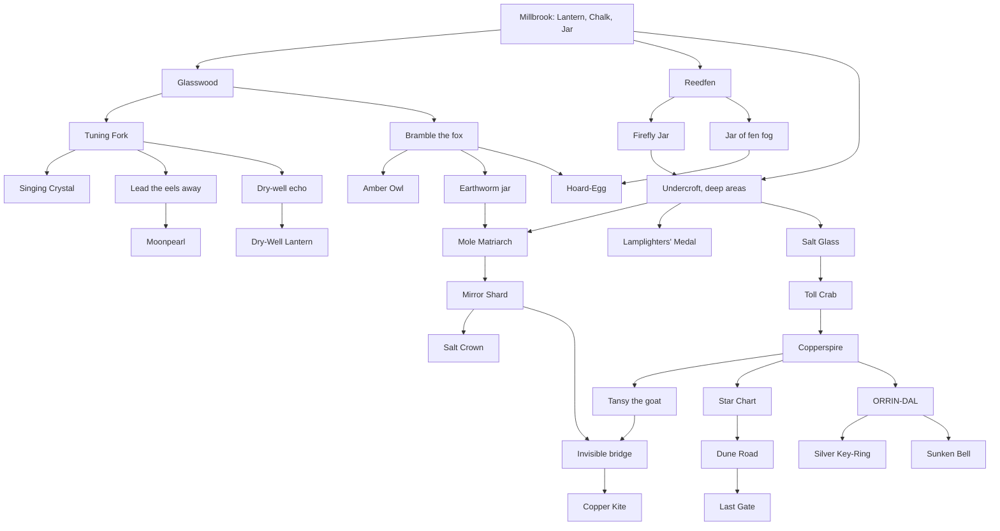

# Hollowmere — Design Document (draft 1)

An original top-down action-adventure for the browser. It borrows the *shape* of early
treasure-hunt adventures (collect everything, carry it to a distant guardian, discover that
magic items do more than one thing) and presents it as a screen-by-screen, Zelda-style
overworld. The world, characters, puzzles, names and art are all new.

---

## 1. Pitch

When the old dam broke, the valley of Hollowmere flooded and its twelve treasures were
scattered across the marsh, the forest and the mines. Legend says that whoever lays all
twelve before the **Owl-Warden**, a stone owl the size of a house that sleeps at the Last
Gate beyond the dunes, will see the Gate open and the valley drain.

You are **Wren**, the village lamplighter's apprentice (the player can rename them). You
have a lantern, a stick of chalk and far too much curiosity.

**Tone:** gentle and a little melancholy, with flashes of humour. Danger is real but not
grim. Think of "a light jaunt that turns out to be a long journey".

## 2. Design pillars

1. **The journey is the point.** Treasures go to the Warden at the far end of the world,
   not back to the start. Carrying a growing pile across the map should feel epic, but it
   should never feel like a chore (see §6, Logistics).
2. **Few tools, many uses.** Each magic item has two to four uses that have nothing to do
   with each other. Discovering a new use is the main "aha" of the game.
3. **Fair secrets.** There are hidden puzzles, but every important one is hinted at least
   twice in the world, and the hint system (§8) covers the rest.
4. **Readable screens.** Anything you can interact with looks interactable: it has a
   subtle outline shimmer when you are near it. Background art is never a trap. This is
   the visual version of separating object text from room text in old text adventures.
5. **No tedious mazes.** Places where you're meant to feel lost are navigation puzzles
   with landmarks and chalk marks, not 40 identical rooms.

## 3. Core loop

Explore a screen → spot something odd → try a tool or companion on it → open a path or
win a treasure → carry the haul forward → occasionally reach a **Mirror Pool** (a
save-and-teleport point) → push toward the Last Gate.

## 4. Controls

| Action | Keyboard | Touch |
| --- | --- | --- |
| Move (4 directions, no diagonals) | Arrows / WASD | On-screen D-pad |
| Interact / attack | Space / J | **A** button |
| Use equipped item | K | **B** button |
| Cycle equipped item | Q / E | Tap item icon |
| Inventory and map | I / Tab | Pack icon |
| Speak a word | Enter (opens a text box) | Speech icon |

Movement is limited to four directions on purpose: it keeps the grid readable and the
puzzles precise.

## 5. World

There are about 45 screens in the full game. Each screen is 16×11 tiles (16 px tiles,
256×176 logical pixels, scaled up). Walking off an edge slides the camera to the next
screen.

```
                 [Copperspire]
                      |
 [Glasswood] — [Millbrook] — [Reedfen]
                      |
                 [Undercroft]  (beneath Millbrook and Glasswood)
                      |
                 [Dune Road] → [Last Gate / Owl-Warden]
```

| Region | Screens | Feel | Main obstacle |
| --- | --- | --- | --- |
| **Millbrook** (start) | 6 | Half-flooded village, safe | Teaches the controls; the shrine inscription |
| **Reedfen** | 6 | Marsh at dusk, fireflies | Mire eels, Toll Crab, fen fog |
| **Glasswood** | 8 | Crystal forest that hums | Crystal walls, Bramble wolves |
| **Undercroft** | 10 | Old mines, completely dark | Lantern light, Ghost Lamplighters, Mole Matriarch |
| **Copperspire** | 7 | Windy mountain, copper roofs | Gusts, invisible bridge, the Word |
| **Dune Road** | 5 + navigation | Endless sand at night | Getting lost (star landmarks) |
| **Last Gate** | 1 | The sleeping Owl-Warden | The final puzzle |

## 6. Systems

### Lantern and darkness
- Undercroft screens and some interiors are dark. You only see within the lantern's
  radius.
- Lantern oil drains **only in the dark**, about 9 minutes of oil when full. There is a
  warning flicker at 20%.
- You can refill at **Ember Braziers**, but there are only three and they are far apart.
- **The hidden solution:** catch fireflies in Reedfen at dusk with the **Glass Jar**. The
  firefly jar never runs out but gives a smaller radius. You can swap between the jar and
  the lantern. Only the lantern burns brambles and lights fuses.

### Pack (inventory) and logistics
- The pack has 10 slots. Treasures take one slot each; tools are always carried and take
  none.
- **Cart Stops:** at three points you can leave treasures in a cart that a mule hauls
  ahead to the next stop. This keeps the "bring it all to the far end" pillar without
  making you walk every item across the map by hand.
- Dropped items stay exactly where you leave them and show on the map.

### Combat
- One sword-like tool, the **Lamplighter's Pole**: a short poke with knockback and
  2 damage.
- You have 3 hearts, and can find up to 2 more as hidden heart-shells.
- Most enemies are puzzles first and fights second. The pole is often the wrong answer,
  and the game says so gently ("The eel coils around the pole and tugs. Wrong idea.").

### Companions
- **Bramble the fox** (Glasswood) follows you once you share bread. It digs at soft-earth
  tiles and chases off the Rook King.
- **Tansy the goat** (Copperspire) follows once untangled from a fence. She headbutts
  cracked boulders. She won't go underground and waits at the Undercroft entrance.
- You can only have one companion at a time. The other waits where you left it.

### Saving
- Mirror Pools autosave and act as teleport anchors once you have the Mirror Shard.
- Three save slots in `localStorage`, plus export and import to a file, like the planner's
  backup feature.

### Score
- 10 points for each treasure laid before the Warden, 5 for each heart-shell and for each
  companion befriended.
- 3 points off for each hint taken and 2 off for each faint (being knocked out sends you
  back to the last Mirror Pool with everything you're carrying).
- The end screen shows the score with a short rank title ("Puddle-Wader" up to
  "Keeper of Hollowmere").

## 7. Magic items: one tool, many uses

| Item | Where | Use 1 (obvious) | Use 2 | Use 3 (hidden) |
| --- | --- | --- | --- | --- |
| **Chalk** | Start | Mark any floor tile (helps with mapping and the Dune Road) | Draw on a door-shaped crack and it becomes a real door | Draw a circle around yourself and Ghost Lamplighters can't cross it |
| **Tuning Fork** | Glasswood | Strike it to shatter crystal walls | Mire eels follow the hum, so you can lead them away from a crossing | Strike it in the dry well: the echo reveals a hidden ledge. **Also the final puzzle.** |
| **Mirror Shard** | Undercroft | Reflect sunbeams onto sun-seals | Teleport back to any Mirror Pool you have visited | Hold it up on Copperspire to reveal the invisible bridge |
| **Glass Jar** | Millbrook | Carry water (put out a burning fuse; fill the dry font) | Catch fireflies for a light that never runs out | Trap the fen fog and release it at the Rook King's nest to blind him |
| **The Word "ORRIN-DAL"** | Whispered by the wind on Copperspire's summit | It seems to make a distant creak and nothing else. It actually opens the spiral-sealed vault in Millbrook | It opens **anything** marked with a spiral, including the sunken bell in Reedfen | Spoken at the Last Gate it does nothing, a deliberate red herring with a funny reply |

## 8. Hints

- Small owl statues in each region give up to three hints each, growing more direct, for
  −3 points per hint. They sound like the Warden "talking in its sleep".
- Every important hidden puzzle also gets two clues placed in the world. For example,
  for the dry well: a child in Millbrook says "Dad says the old well sings", and the well's
  sign reads "Listen before you climb".

## 9. Characters and creatures

| Who | Where | Problem or role | Answer |
| --- | --- | --- | --- |
| **The Rook King** | Wanders Millbrook and Reedfen after you first meet him | Steals one shiny item when he passes | Bramble chases him off. His nest (blinded with jar fog) holds everything he stole and a treasure |
| **Mire eels** | Reedfen crossings | Pull you underwater | Lead them away with the Tuning Fork |
| **Toll Crab** | Reedfen causeway | Demands "something from the sea" | Give it the Salt Glass from the Undercroft salt pans, not a treasure (giving a treasure works but costs you the treasure for good, and the crab apologises) |
| **Bramble wolves** | Glasswood | Packs that circle you | Lantern light scares them; the Pole works but is slow |
| **Ghost Lamplighters** | Undercroft | Drain your lantern when they touch you | Chalk circle, or relight their old lamps, which turns them into helpers who light that screen permanently |
| **Mole Matriarch** | Deep Undercroft | Blocks the tunnel and is grumpy about the noise | Bring her the jar of earthworms that Bramble dug up. She gives you the Mirror Shard |
| **Old Pell** | Millbrook | The retired lamplighter and your mentor | Tutorial, some lore, sells nothing, mildly sarcastic |
| **The Owl-Warden** | Last Gate | The guardian | §11 |

## 10. Treasures (12)

| # | Treasure | Puzzle |
| --- | --- | --- |
| 1 | Brass Weathercock | Millbrook rooftop, reached by stacking crates |
| 2 | Moonpearl | Reedfen: lead the eels away, dive at the crossing |
| 3 | Sunken Bell | Reedfen: say ORRIN-DAL at the spiral on the bell rope |
| 4 | Singing Crystal | Glasswood: shatter the crystal wall with the Fork |
| 5 | Amber Owl | Glasswood: Bramble digs at the soft earth by the stump |
| 6 | Salt Crown | Undercroft: sun-seal opened with the Mirror Shard |
| 7 | Lamplighters' Medal | Undercroft: relight all four ghost lamps |
| 8 | Copper Kite | Copperspire: invisible bridge, with Tansy headbutting the boulder |
| 9 | Star Chart | Copperspire summit (this is also where the Word is) |
| 10 | Silver Key-Ring | The Millbrook vault (ORRIN-DAL) |
| 11 | Rook King's Hoard-Egg | The blinded Rook King's nest |
| 12 | Dry-Well Lantern | The hidden ledge in the dry well (Fork echo) |

## 11. The ending

- An inscription on the Millbrook shrine, seen in the first minute and easy to forget:
  *"The Warden weighs no gold while you still hold your light."*
- **Dune Road:** the Star Chart shows three constellations. Walk toward each one in turn
  as it rises over the dunes. The wrong direction loops back with a gentle "you've seen
  this dune before". Chalk marks help. It takes about 2 minutes once you understand it.
- **At the Last Gate:** lay all twelve treasures in the bowl. Nothing happens. Put down
  the lantern (and the jar), and the screen goes dark. Strike the Tuning Fork. The Warden's
  eyes open, it counts the treasures out loud, and the Gate opens. The valley drains in a
  closing sequence that revisits the regions you have been through.
- With fewer than 12 treasures the Warden opens one eye and names how many are missing,
  with a vague hint about where.

## 12. Puzzle dependencies



The key hidden puzzle (like the fairy grotto in older games) is **the firefly jar**. The
game is beatable by managing lantern oil carefully, but the jar makes it relaxed.
Learning from that older design, nothing *essential* depends on a single puzzle the player
might not know exists.

## 13. Art and audio

- **Art:** pixel art on 16×16 tiles in an original limited palette (dusky teal, lamp amber
  and moss green). The first version draws all sprites in code or as hand-made PNGs in the
  repo, with no third-party or copyrighted assets.
- **Lighting:** a darkness overlay with radial "holes" cut for the lantern, fireflies and
  braziers. This is the signature look.
- **Audio:** music and sound effects synthesised at runtime with WebAudio, so no audio
  files are needed. There is a mute toggle.

## 14. Technical plan

- **Stack:** vanilla JavaScript (ES modules) and HTML5 canvas, with no build step and no
  dependencies, the same approach as the planner. It is served by the existing GitHub
  Pages site at `/hollowmere/`.
- **Structure:**
  ```
  hollowmere/
    index.html
    src/  main.js  engine/(loop, input, render, light, audio)  game/(player, items, npc, rooms)
    data/ world.json  (screens as tile grids + entity lists)  items.json  dialogue.json
    art/  tiles.png  sprites.png
  ```
- Screens, entities and dialogue are **data-driven**, so content can be added without
  touching engine code. A simple text-grid format for screens can be edited by hand.
- Fixed 60 Hz update with integer scaling. On phones it runs in portrait with the D-pad
  and buttons below the play area.

## 15. Milestones

1. **Engine and one test room:** movement, collision, screen transitions, touch and
   keyboard input, dialogue box.
2. **Vertical slice (about 15 screens):** Millbrook, Reedfen and part of Glasswood, plus a
   short Undercroft section. Lantern, Chalk and Tuning Fork, 5 treasures, eels, wolves and
   ghosts, and a temporary Warden placed near the start for the ending.
3. **Full world:** remaining regions, companions, Mirror Shard, the Word, the Dune Road.
4. **Polish:** audio, hints, score and ranks, save export, playtesting the hidden-puzzle
   hints.

## 16. Open questions for you

1. Is the **tone and setting** right (flooded valley, lamplighter apprentice, stone owl
   guardian), or would you prefer something else, like desert ruins or a sky-island world?
2. **Combat level:** keep it light and puzzle-first as written, or more action with more
   enemies and bosses?
3. **Logistics:** do you like Cart Stops, or would you prefer the old-school "carry it all
   yourself" challenge as an optional hard mode?
4. **Who is it for?** If it's for a younger player (the planner was built for a teenager),
   should faints be softer, with no item loss, and the Undercroft less dark?
5. Is **Hollowmere** OK as a working title?
