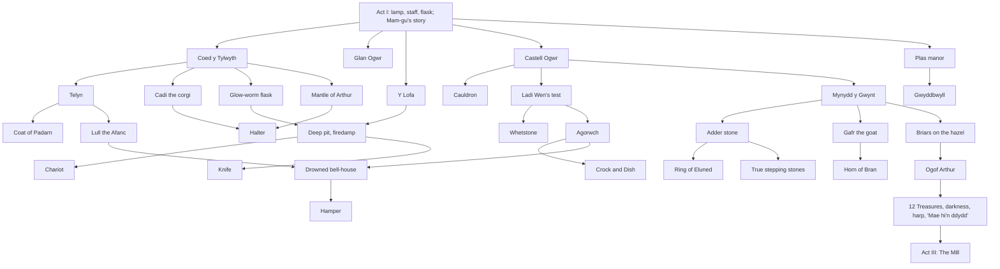

# Melin Ifan Ddu — Design Document (draft 2)

*Black Ifan's Mill.* An original top-down action-adventure for the browser, rooted in Welsh
folklore and Arthurian legend and set in and around Blackmill (Melin Ifan Ddu), where the
Ogwr Fach meets the Ogwr Fawr. It keeps the shape of early treasure-hunt adventures:
collect everything, carry it to a distant guardian, and find that magic items do more than
one thing. It presents that as a screen-by-screen, Zelda-style overworld.

Draft 2 replaces the "Hollowmere" setting from draft 1. The systems are mostly the same;
the world, story, cast and treasures are new.

> **About Black Ifan:** nobody seems to know who the real Ifan of Blackmill's name was. The
> villain in this game is **invented** and isn't meant as a claim about any real person or
> local history.

---

## 1. Pitch

Long ago, a miller called **Ifan** made a bargain with **Gwyn ap Nudd**, lord of the
Otherworld, Annwn. In exchange for one black millstone from Annwn, Ifan would never grow
old. The catch is that the stone grinds **years**, not grain. Anyone bound to turn the
mill's great wheel grows grey while Ifan stays young. The flour comes out black.

For generations the people of the valley were dragged into the mill as "the Bound". Now
Ifan Ddu has a bigger plan. Hidden in the hills are the **Thirteen Treasures of the Island
of Britain**, left behind by the warriors who sleep with **Arthur** in a cave beneath the
mountain. If Ifan grinds the Treasures under the black stone, Arthur will never wake, and
the valley will be his for good.

You are **Dryw** (Welsh for *wren*, the "king of birds" in Welsh tradition; the player can
rename them). You're a young miner's child from Blackmill, and your Mam-gu has just been
taken to the mill. You need to find the Treasures before Ifan's Millhands do, return them
to the sleeping king, and tell Arthur that **it is day**.

**Tone:** a folk tale with real menace, fairly dark but never graphic. The mill is a
frightening place, there is humour in the people and creatures you meet, and the ending is
hopeful. It's aimed at roughly ages 12 and up (see §15).

## 2. Design pillars

1. **The journey is the point.** Treasures go to Arthur's cave, deep in the hills, not
   back home. Carrying the haul across the valley should feel epic, not like a chore
   (§6, the Chariot).
2. **Few tools, many uses.** Each magic item has two to four uses that have nothing to do
   with each other. Discovering a new use is the main "aha" of the game.
3. **Fair secrets.** Every important hidden puzzle is hinted at least twice in the world.
   The owl Blodeuwedd covers the rest (§8).
4. **Readable screens.** Anything you can interact with has a subtle shimmer when you are
   near it. Background art is never a trap.
5. **No tedious mazes.** Places meant to confuse you, like the fog on the mountain or the
   old pit roads, are navigation puzzles with landmarks, not rows of identical rooms.
6. **Welsh first.** Place names, creatures and key phrases are Welsh, with a pronunciation
   guide (§14) and English subtitles. The game should make a Welsh speaker smile, not
   wince. Have a Welsh speaker check all the Welsh before release.

## 3. Structure: three acts

| Act | Title | What happens |
| --- | --- | --- |
| **I** | *Y Pentref* (The Village) | Blackmill under Ifan's shadow. Mam-gu is taken. Learn the controls, get the miner's lamp and hazel staff, and hear the old story of the sleeping king. |
| **II** | *Y Trysorau* (The Treasures) | Open world. Find the cave under the hazel tree, then recover 12 Treasures from the valley, the woods, the pit, the castle and the mountain, racing Ifan's Millhands. Each Treasure goes on its plinth in the cave. |
| **III** | *Y Felin* (The Mill) | Wake Arthur. With the knights riding behind you, storm the mill, free the Bound and face Black Ifan. The 13th Treasure, the flaming sword **Dyrnwyn**, is in his hands. |

## 4. Controls

| Action | Keyboard | Touch |
| --- | --- | --- |
| Move (4 directions, no diagonals) | Arrows / WASD | On-screen D-pad |
| Interact / attack | Space / J | **A** button |
| Use equipped item | K | **B** button |
| Cycle equipped item | Q / E | Tap item icon |
| Inventory and map | I / Tab | Pack icon |
| Speak (Welsh words and answers) | Enter (word wheel) | Speech icon |

Spoken words come from a **word wheel** of words you've learned, so nobody has to type
Welsh spelling correctly.

## 5. World

About 50 screens. Each screen is 16×11 tiles (16 px tiles, 256×176 logical pixels, scaled
up). The regions are *inspired by* the real area around Blackmill. The geography is bent
for the game, and places marked † are fictional.

```
                    [Mynydd y Gwynt †] —— [Ogof Arthur]
                     (mountain)            (Arthur's cave, under the hazel)
                          |
 [Coed y Tylwyth †] — [BLACKMILL] — [Glan Ogwr †]
  (fairy wood)        village +      (river meadows, the Ogwr)
                      [THE MILL]          |
                          |          [Castell Ogwr]
                     [Y Lofa †]      (Ogmore Castle + stepping stones)
                     (the old coal pit)
```

| Region | Screens | Feel | Folklore / main obstacle |
| --- | --- | --- | --- |
| **Blackmill** (start) | 6 | Terraced village in the valley bottom, Millhand patrols | Teaches the controls; the chapel vault; Mam-gu's stories |
| **Glan Ogwr** † | 6 | River meadows, mist, where the two rivers meet | **Ceffyl Dŵr** (water horse), **Afanc** (river monster) |
| **Coed y Tylwyth** † | 8 | Ancient oak wood, fairy rings | **Tylwyth Teg** (the Fair Folk), **Cŵn Annwn** (Otherworld hounds) |
| **Y Lofa** † | 10 | Abandoned coal pit, completely dark | **Coblynau** (mine knockers), firedamp, the lamp |
| **Castell Ogwr** | 5 | Ruined castle, stepping stones over the river | **Y Ladi Wen** (the White Lady) and her treasure, a real local legend |
| **Mynydd y Gwynt** † | 7 | High moor, wind and fog, wild goats | **Gwrach y Rhibyn** (the hag of the mist), the Word |
| **Ogof Arthur** | 2 | Cave of sleeping warriors, the bell | The final ritual (§11) |
| **The Mill** (Act III) | 8 | The dungeon | §10 |

## 6. Systems

### The miner's lamp and darkness
- Y Lofa, the cave and the mill cellars are dark. You only see within the lamp's radius.
- Oil drains **only in the dark**, about 9 minutes when full, with a flicker warning at
  20%. You can refill at three old **pit braziers**.
- **Firedamp:** the flame burns **blue and tall** near gas, just like a real safety lamp.
  You must not light anything there or use Dyrnwyn's fire. Ventilation doors fix it.
- **The hidden solution:** on summer nights in the fairy wood, catch glow-worms
  (*pryfed tân*) in the **stone flask**. That light never runs out and is safe in
  firedamp, but its radius is smaller and it can't burn or ignite things.

### Pack and the Chariot of Morgan Mwynfawr
- The pack has 10 slots. Treasures take one slot each; tools take none.
- One of the Thirteen Treasures is the **Chariot of Morgan Mwynfawr**, which in legend
  takes its rider anywhere in an instant. Once you restore it (in Y Lofa, mid-game), any
  **holy well** (*ffynnon*) can send your carried Treasures straight to the cave, and the
  wells become fast-travel points. Before that, you carry everything by hand,
  old-school style. An optional **"Hen Ffordd" (Old Way)** hard mode turns the Chariot's
  delivery off.

### Combat
- Your weapon is the **hazel staff**: a short strike with knockback and 2 damage.
- You start with 3 hearts and can earn up to 2 more as hidden **love spoons** (*llwyau
  caru*).
- Most enemies are puzzles first and fights second. The game gently signals when the
  staff is the wrong answer.

### Companions
- **Cadi the corgi.** In legend the Tylwyth Teg rode corgis; you can still see the saddle
  marks on their backs. Cadi follows you after you rescue her from a Millhand. She digs
  at soft earth, barks at hidden Tylwyth Teg, and herds the Ceffyl Dŵr.
- **Gafr the wild goat** (mountain) follows you once you untangle her from barbed wire.
  She headbutts cracked rock and keeps her footing in the wind. She won't go underground.
- You can only have one companion at a time. The other waits where you left it.

### Saving
- Holy wells autosave.
- Three save slots in `localStorage`, plus export and import to a file.

### Score
- 10 points for each Treasure placed in the cave, 5 for each love spoon, companion
  befriended and group of Bound you free.
- 3 points off for each hint and 2 off for each faint (a faint sends you to the last well
  with everything you're carrying).
- The end screen gives a bardic rank, from *Disgybl* (apprentice) up to *Pencerdd*
  (chief bard).

## 7. Tools: one tool, many uses

| Tool | Where | Use 1 (obvious) | Use 2 | Use 3 (hidden) |
| --- | --- | --- | --- | --- |
| **Hazel staff** (*ffon gollen*) | Act I, cut from the hazel over the cave (you don't know that yet) | Weapon | **Dowsing**: it twitches toward buried treasure | Draw a circle with it and spirits (Cŵn Annwn, Millhand wraiths) can't cross |
| **Telyn** (small harp) | Coed y Tylwyth, won from the Tylwyth Teg | Play the **lullaby** to put the Afanc to sleep | Play the **dance** to open a fairy ring | A held note makes the cave bell ring with no hand on it (Act III) |
| **Glain neidr** (adder stone) | Mynydd y Gwynt | Look through it to see the hidden Tylwyth Teg paths | See a creature's **true form** (some Millhands are just sacks on poles) | On Castell Ogwr's stepping stones it shows which stones are real |
| **Stone flask** | Blackmill | Carry water (put out fuses, fill the dry font) | Catch glow-worms for a light that never runs out | Catch the hag's mist and release it in the mill to blind the overseers |
| **The Word *"Agorwch!"*** ("Open!") | The Ladi Wen tells you, if you pass her test | You hear a groan of stone far away, and that's all. It actually opens the chapel vault in Blackmill | It opens **anything carved with the triple spiral**, including the drowned bell-house in Glan Ogwr | Said in Ogof Arthur it does nothing, a red herring with a funny reply |
| **Miner's lamp** | Act I | Light | Detects firedamp | Burns away the briars round the hazel tree that hides the cave |

## 8. Hints: Blodeuwedd

In the Mabinogion, **Blodeuwedd** was made from flowers and turned into an owl. Here she
perches in each region and gives up to three hints each, more direct each time, for −3
points per hint. She's sharp-tongued and sympathetic, and has her own grudge against
sorcerers who bend people to their will.

Every important hidden puzzle also gets two clues placed in the world. For example, for
the hazel tree: Mam-gu's story ("the cave is under a hazel; the shepherd cut his staff
from it"), and the dowsing staff pulling hard toward a briar patch on the mountain.

## 9. The Thirteen Treasures

These are from the medieval Welsh list *Tri Thlws ar Ddeg Ynys Prydain*, as it appears in
later manuscripts. The list varies between sources; this version uses Eluned's ring as the
13th. In legend each Treasure has a magic property, and here many are also **tools**
while you carry them. Placing one in the cave gives up its power, which makes the
decision interesting. After Arthur wakes, he lends three back for the mill (§10).

| # | Treasure | Legend | In the game: where and how | Power while carried |
| --- | --- | --- | --- | --- |
| 1 | **Hamper of Gwyddno Garanhir** | Food for one becomes food for a hundred | Glan Ogwr: lull the Afanc with the harp and dive at the bell-house (opened with *Agorwch*) | Restores hearts. In Act III it feeds the starving Bound |
| 2 | **Horn of Brân Galed** | Gives any drink you wish for | Mynydd y Gwynt: Gafr headbutts open the goat ledge | Blow it to stop the wind gusts for 10 seconds |
| 3 | **Chariot of Morgan Mwynfawr** | Takes you anywhere | Y Lofa: rebuild it from three parts the Coblynau guard | Fast travel and delivery (§6) |
| 4 | **Halter of Clydno Eiddyn** | The horse you wish for appears in it | Glan Ogwr: the Ceffyl Dŵr wears it. Cadi herds it into the shallows and you approach unseen (Mantle) | Summon a horse to cross the river meadows quickly |
| 5 | **Knife of Llawfrodedd the Horseman** | Serves a meal for 24 | Y Lofa: knock back the Coblynau's rhythm on the coal face | Cuts through ropes, nets and Millhand chains |
| 6 | **Cauldron of Dyrnwch the Giant** | Won't boil a coward's meat | Castell Ogwr kitchens: stand your ground as the Ladi Wen's ghosts rush you (don't flee or strike) | — (a test, not a tool) |
| 7 | **Whetstone of Tudwal Tudglyd** | A brave man's blade sharpened on it will kill | Under Castell Ogwr: the Ladi Wen offers half her gold. Take **only the whetstone** (see below) | Staff damage ×2 |
| 8 | **Coat of Padarn Beisrudd** | Fits only the worthy | Coed y Tylwyth: dance in the fairy ring. **Fairy time:** you come out and a day has passed in-game (Millhands have moved and Mam-gu's lines change) | Halves damage |
| 9 | **Crock and Dish of Rhygenydd** | Whatever food you wish for | Blackmill chapel vault (*Agorwch*) | Trade food with the Coblynau and Tylwyth Teg |
| 10 | **Gwyddbwyll board of Gwenddoleu** | The pieces play by themselves | Plas † manor between the wood and the river: a self-playing board-game logic puzzle | Its pieces show patrol routes in the mill |
| 11 | **Mantle of Arthur** | Whoever wears it can't be seen | Coed y Tylwyth: survive the hunt of the Cŵn Annwn inside a staff circle until dawn | Invisible to enemies while standing still |
| 12 | **Stone and Ring of Eluned** | Conceals the wearer | **The hidden key puzzle:** in the holy well on the mountain, only visible through the adder stone | Teleport back to the cave from anywhere |
| 13 | **Dyrnwyn**, sword of Rhydderch Hael | Bursts into flame when drawn by a worthy hand | Held by Black Ifan. Taken in the final battle | Flaming sword (Act III only) |

**The Ladi Wen's test** is based on the real Ogmore legend, where a man who came back
greedy for the rest of her treasure was cursed. Take anything besides the whetstone and
the gold turns to leaves, she scratches you (−1 heart for good), and she won't teach you
*Agorwch*. You then have to find the Word another way: a much longer route through the
mountain mist with Gwrach y Rhibyn. The puzzle can't become impossible.

## 10. The Mill (Act III dungeon)

The mill is the dark heart of the game. Its horror comes from atmosphere and implication,
not gore:

- **Y Rhod (The Wheel):** a huge treadwheel turned by the Bound, grey-haired villagers
  who were young last week. The rhythm of the wheel drives the music of the whole level.
- **Y Llofft Gadwyn (The Chain Loft):** rows of empty shackles and the names of the taken
  scratched into the beams, Mam-gu's among them. Chains are cut with the Knife.
- **Y Pydew (The Pit):** the punishment cellar beneath the millrace. Cold water, the
  sound of the grinding stone overhead and a cell door for each person who refused to
  turn the wheel. You find Mam-gu here.
- **Y Maen Du (The Black Stone):** the Annwn millstone, grinding years into black flour.
- **The Millhands:** Ifan's overseers. They wear flour sacks for hoods; through the adder
  stone, some turn out to be empty sacks on poles held up by Annwn magic. They patrol on
  routes shown by the Gwyddbwyll pieces.

**Three loaned Treasures:** after waking, Arthur gives back three Treasures of your
choice for the assault. The Mantle (stealth), Knife (chains) and Hamper (feeding the
Bound) is the obvious set, but others work too.

**Freeing the Bound:** each group you free (cut chains, feed, guide to a well) gives back
some of their years, and they slowly grow young again. Freed groups help at the end by
jamming the wheel.

**Black Ifan:** tall, young-faced, eyes like old men's, dusted in black flour. The fight
has three phases:
1. He fights with Dyrnwyn, but the sword **won't flame for him** because he is unworthy.
   Its hilt smokes and burns him.
2. Disarm him with the staff and catch Dyrnwyn. It **blazes** for you.
3. Ifan retreats to the Black Stone and grinds the wheel faster, ageing the Bound. Jam the
   wheel with the freed villagers' help, then use Dyrnwyn's flame to crack the stone.

Without the stone, all his stolen years catch up with Ifan Ddu at once and he crumbles to
black flour in the millrace. The mill falls silent. Gwyn ap Nudd's hounds are heard
calling far off as they come to collect what they're owed.

## 11. Ogof Arthur and the ending

The cave comes from a widespread Welsh legend. A man cuts a hazel staff, and a stranger
recognises the tree and leads him to a cave under its roots. Arthur and his warriors
sleep there among treasure. A bell hangs in the passage. If you touch it a warrior wakes
and asks **"Ydy hi'n ddydd?"** ("Is it day?"), and the only safe answer is **"Nac ydy,
cysga di"** ("No, sleep on").

- **Act I:** Mam-gu tells you the story and warns you to always answer "No, sleep on".
- **Act II:** you find the cave by burning the briars round the hazel that your staff was
  cut from. There are 12 plinths around the sleeping king. Touch the bell early, answer
  "No", and you're safe. Answer "Yes" and the warrior is angry and throws you out (a
  faint), and you learn not to.
- A carving above the plinths, only readable through the adder stone, says:
  *"Pan fo'r Trysorau gartref, dywed y gwir."* ("When the Treasures are home, tell the
  truth.")
- **The ritual:** with all 12 in place, put out your lamp and the glow-worms so that the
  cave is in true darkness, then play a held note on the harp. The bell rings by itself.
  The warrior asks *"Ydy hi'n ddydd?"* and for the first time you answer **"Mae hi'n
  ddydd"** ("It is day"). Arthur wakes. Act III begins.
- With fewer than 12 Treasures, the waking warrior counts the empty plinths and goes back
  to sleep grumbling, with a vague hint about where the missing ones are.
- **Epilogue:** with the mill silent, Arthur and the knights return to sleep, because
  Britain isn't yet in its greatest need. Dryw plants a new hazel by Mam-gu's door, and
  the valley, the river and the colours of the village are restored.

## 12. Puzzle dependencies



The key hidden puzzles are the **glow-worms**, which make the dark comfortable but aren't
required, and the **adder stone**, which is signposted heavily because it unlocks several
things. Nothing essential depends on a puzzle the player might not know exists.

## 13. Art and audio

- **Art:** pixel art on 16×16 tiles in an original palette: slate-grey terraces, wet
  green hills, lamp amber and the mill's soot-black and flour-white. Act III loses colour,
  and the epilogue brings it back. All art is drawn for the project, with no third-party
  or copyrighted assets.
- **Lighting:** a darkness overlay with radial holes for the lamp, glow-worms and
  Dyrnwyn. The lamp turns blue in firedamp.
- **Audio:** synthesised at runtime with WebAudio. Melodies are **original** but written
  in the style of Welsh folk tunes and harp music. A traditional tune that is definitely
  public domain, such as *Ar Lan y Môr*, could be arranged later. The mill's level uses
  the treadwheel as its percussion.

## 14. Pronunciation guide (shown in-game)

These are rough English approximations. A Welsh speaker should check them.

| Welsh | Say it like | Meaning |
| --- | --- | --- |
| Melin Ifan Ddu | MEL-in EE-van THEE | Black Ifan's Mill (Blackmill) |
| Dryw | DREE-oo | Wren |
| Mam-gu | mam-GEE | Grandmother (South Wales) |
| Ogwr | OG-oor | Ogmore (the river) |
| Tylwyth Teg | TUL-with TAIG | The Fair Folk |
| Cŵn Annwn | KOON AN-noon | Hounds of the Otherworld |
| Coblynau | kob-LUN-eye | Mine knockers |
| Ceffyl Dŵr | KEF-il DOOR | Water horse |
| Afanc | AV-ank | River monster |
| Y Ladi Wen | uh LAH-dee WEN | The White Lady |
| Gwrach y Rhibyn | GROOKH uh HRIB-in | Hag of the mist |
| Glain neidr | GLINE NAY-dir | Adder stone |
| Ffynnon | FUN-non | Well / spring |
| Blodeuwedd | blod-AY-weth | "Flower-face" |
| Dyrnwyn | DURN-win | "White-hilt" |
| Gwyn ap Nudd | GWIN ap NEETH | Lord of Annwn |
| Agorwch! | ag-OR-ookh | Open! |
| Ydy hi'n ddydd? | UH-dee heen THEETH | Is it day? |
| Nac ydy, cysga di | NAK UH-dee, KUS-ga dee | No, sleep on |
| Mae hi'n ddydd | MY heen THEETH | It is day |

A full Welsh-language mode (*Cymraeg* toggle) would be a good stretch goal.

## 15. Audience and content

- **Target:** roughly ages 12 and up. Forced labour, imprisonment and cruelty are shown
  through **setting and consequences**: chains, ageing, cells, names on the beams, the
  Pit's cold water. There's no on-screen torture or gore. The emotional weight comes from
  Mam-gu and the Bound, and the payoff is freeing them.
- Faints never delete progress. Holy wells come before every hard section.
- The darkness, the hounds and Ifan can be properly scary. An options toggle can make
  the dark areas lighter and slow the hunts.

## 16. Technical plan

- **Stack:** vanilla JavaScript (ES modules) and HTML5 canvas, with no build step and no
  dependencies, the same approach as the planner. It is served by the existing GitHub
  Pages site at `/melin-ifan-ddu/`.
- **Structure:**
  ```
  melin-ifan-ddu/
    index.html
    src/  main.js  engine/(loop, input, render, light, audio)  game/(player, items, npc, rooms, acts)
    data/ world.json  items.json  dialogue.cy.json  dialogue.en.json
    art/  tiles.png  sprites.png
  ```
- Screens, entities and dialogue are **data-driven**. Dialogue is split by language from
  the start, so Welsh and English stay in sync and a Cymraeg mode is cheap to add later.
- Fixed 60 Hz update with integer scaling. On phones it runs in portrait with the D-pad
  and buttons below the play area.

## 17. Milestones

1. **Engine and one test room:** movement, collision, screen transitions, touch and
   keyboard input, dialogue box and word wheel.
2. **Vertical slice (about 15 screens):** Act I in Blackmill, plus Glan Ogwr and the
   start of Coed y Tylwyth. Lamp, staff and harp, Cadi, 3 Treasures (Hamper, Mantle,
   Crock and Dish), the Afanc, the Cŵn Annwn hunt, and a short version of the cave and
   its bell question.
3. **Act II complete:** Y Lofa, Castell Ogwr, Mynydd y Gwynt, all 12 Treasures, the
   Chariot and the wells.
4. **Act III:** the mill and Black Ifan.
5. **Polish:** audio, Blodeuwedd hints, score and ranks, save export, a Welsh language
   check, accessibility options.

## 18. Open questions for you

1. **Black Ifan's backstory:** a miller who made a deal with Gwyn ap Nudd for eternal
   youth, with a mill that grinds people's years. Is that the right kind of evil, or
   should he be more human, like a cruel mill-owner and taskmaster with only a little
   magic?
2. **Darkness level:** is the content approach in §15 right for who's going to play it?
3. **Real places:** how close to real Blackmill should it be? You could describe or
   sketch landmarks (the chapel, the bridge, the old railway, particular hills), and I can
   swap the † fictional names for real ones.
4. **Welsh:** is there a Welsh speaker who could check the language? Do you want a full
   Cymraeg mode eventually?
5. **Title:** *Melin Ifan Ddu* in Welsh, with "Black Ifan's Mill" as the English
   subtitle?
