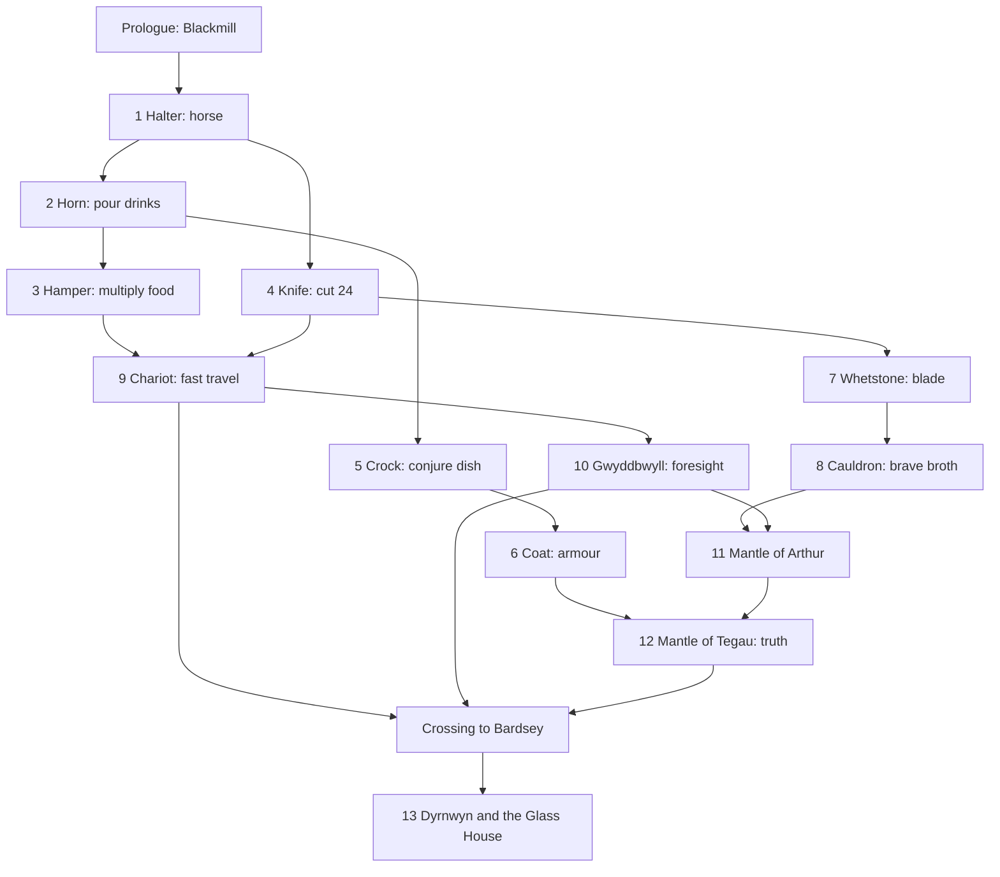

# The Thirteen Treasures — Design Document (draft 3)

An original top-down, Zelda-style adventure for the browser that retells British and Welsh
myth through a quest for the **Thirteen Treasures of the Island of Britain**. Each Treasure
gets its own chapter built on its legend, and each one's magic becomes a power you use
for the rest of the game.

**What changed from draft 2:**
- The Treasures are now the whole adventure.
- English comes first. Legends, characters and some place names stay Welsh where that's
  part of the charm.
- Mam-gu is gone, and Black Ifan is parked (§12).
- The game starts in Blackmill and ends at Merlin's Glass House.

---

## 1. Pitch

In the old stories, **Merlin** gathered the Thirteen Treasures of the Island of Britain and
took them to his **Glass House** on Bardsey Island, the island of twenty thousand saints
off the end of the Llŷn peninsula. They were never seen again.

Then one night the Glass House shatters. Nobody knows how. The Thirteen Treasures scatter
back across the land and fall into the stories they came from: a drowned kingdom, a
giant's hall, a fairy wood, a haunted castle, a sleeping king's cave.

In the river at **Blackmill**, **Wren** finds a shard of singing glass. It speaks in
Merlin's voice, faint and cracked: *"Bring them home."* The shard hums when a Treasure is
near.

The journey runs from Blackmill in the south to Bardsey in the far north-west, through
the myths on the way.

**Tone:** an adventurous folk tale, full of wonder, with moments of real menace and a lot
of humour from the legends' characters, who are often vain, grumpy or ridiculous.
Suitable for about 10 and up.

## 2. Design pillars

1. **Every Treasure is a story.** Each chapter retells a real legend in play, and its
   puzzle is the Treasure's own rule (the cauldron that won't boil for a coward, the
   sword that burns the unworthy).
2. **Treasures are tools.** Like Zelda dungeon items, every Treasure you win gives a
   power that opens new places and solves old puzzles. Coming back with a new Treasure is
   the main joy of exploring.
3. **The journey is the point.** Treasures go home to the Glass House at the far end of
   the world, not back to the start.
4. **Fair secrets.** Every important hidden thing is hinted twice in the world, and
   Blodeuwedd the owl gives hints.
5. **Readable screens.** Anything you can interact with shimmers when you're near it.
6. **A light touch of Welsh.** The game is in English. Names of characters, creatures and
   legends are kept, with a one-line explanation the first time you hear each one. There
   are no Welsh phrases you have to use.

## 3. How the game is structured

- **Blackmill (prologue):** Wren's home village where the rivers meet. Find the Glass
  Shard, learn the controls, and win the first, easy Treasure.
- **The Map of Britain:** a stylised overworld running north from Blackmill. Regions open
  as you gain Treasure powers. For example, the Halter's horse jumps rivers and the
  Horn's water douses a burning bridge.
- **Treasure Chapters:** 12 self-contained quests (§5), each with an entry, a puzzle
  space or dungeon, the legend's test, and the Treasure. After the first few, you can do
  them in many different orders.
- **The Glass House (finale):** cross to Bardsey and rebuild the house with the Treasures.
  The 13th, **Dyrnwyn**, is decided by how you played (§6).

There is no main villain in this draft. The pressure comes from the legends themselves:
the **Hounds of Annwn** hunt anyone carrying Treasures at night, giants and spirits guard
their prizes, and there's the mystery of who broke the Glass House.

## 4. Controls

| Action | Keyboard | Touch |
| --- | --- | --- |
| Move (4 directions) | Arrows / WASD | D-pad |
| Interact / attack | Space / J | **A** |
| Use equipped Treasure | K | **B** |
| Cycle Treasure | Q / E | Tap Treasure icon |
| Treasure wheel and map | I / Tab | Pack icon |

## 5. The Treasure Chapters

The list is the traditional one, using the later manuscripts' version with **Tegau's
Mantle** as one entry. Each row gives the legend in a nutshell, what the chapter is, the
test, and the power you keep.

| # | Treasure | The legend | The chapter | The test | Power you keep |
| --- | --- | --- | --- | --- | --- |
| 1 | **Halter of Clydno Eiddyn** | Tie it to your bedpost and the horse you wish for will be standing in it by morning | **Prologue, Blackmill:** the Halter is caught on a wild river pony that's terrorising the village allotments | Calm the pony instead of chasing it, by working out what spooked it | **Summon a horse:** fast overworld travel, jump streams and fences |
| 2 | **Horn of Brân Galed** | Holds whatever drink you wish for | **The Thirsty Valley:** a valley in drought. A grumpy giant has dammed the river to keep it for himself | Outwit the giant at a drinking contest, since the Horn never empties, but only once you've found it in his cellar | **Pour any drink:** water (fires, plants), milk (the Fair Folk love it), mead (sends guards to sleep) |
| 3 | **Hamper of Gwyddno Garanhir** | Food for one becomes food for a hundred | **The Drowned Hundred (Cantre'r Gwaelod):** Gwyddno's kingdom under the sea, lost when the drunken watchman Seithennyn left the floodgates open. Its bells still ring under the waves | Find Seithennyn's ghost, sober him up (Horn: water) and get him to close the gates in time, in a timed tide puzzle | **Multiply food:** one apple feeds a flock, a pack or an army, so it calms or recruits groups |
| 4 | **Knife of Llawfrodedd the Horseman** | Serves twenty-four people at once | **The Knockers' Pit:** an old mine where the Knockers, small mine spirits, knock warnings | Learn their knock-language (rhythm puzzle) to cross the collapsing galleries | **Cut 24 things at once:** sweep through webs, briars and ropes in one stroke |
| 5 | **Crock and Dish of Rhygenydd the Scholar** | Whatever food you wish for appears | **The Fair Folk's Wood:** the Tylwyth Teg (fairies) hold a feast and steal the Crock for it | Get into the fairy ring (pour milk), dance without stepping out, and remember that **time runs differently**: a minute inside is a day outside | **Conjure a dish:** give any creature exactly what it craves (bribes, trades, cures) |
| 6 | **Coat of Padarn Red-Coat** | Fits a person of true worth and no one else | **The Saint's Road:** pilgrims, beggars and a disguised Saint Padarn along an old pilgrim route | The Coat only fits after you've helped people who can't repay you. It tracks kindness quietly | **Armour:** halves damage, and shrinks if you are cruel |
| 7 | **Whetstone of Tudwal Tudglyd** | Sharpens a brave person's blade so it always wounds; a coward's stays blunt | **Ogmore Castle:** the White Lady (a real local ghost) guards treasure under the ruins and offers you half her gold | Take **only the Whetstone**. In the legend greed gets you cursed, so here the gold turns to leaves and she scratches you | **Sharpen:** your staff becomes a blade, but only while you don't run from fights |
| 8 | **Cauldron of Dyrnwch the Giant** | Won't boil a coward's meat | **The Giant's Hall:** borrowed from *Culhwch and Olwen*, where Arthur's men raid a giant's hall for his cauldron | Stand your ground while the hall tests you with charging ghosts, a collapsing floor and the giant's roar. Flinch and the water won't boil | **Brave broth:** cook a meal that gives a full heal and a temporary extra heart, but only if you've been brave since the last meal |
| 9 | **Chariot of Morgan the Wealthy** | Takes its rider wherever they wish, at once | **The Broken Road:** the Chariot lies in pieces along a Roman road haunted by marching ghost legions | Find the wheels, the axle and the yoke. Each is held by a ghost who wants something different | **Fast travel** between places you've visited, and it can carry Treasures home to Bardsey |
| 10 | **Gwyddbwyll board of Gwenddoleu** | A board game whose pieces play by themselves | **The Wild Wood:** Merlin wandered mad in this forest after the battle where King Gwenddoleu fell. The board still plays the battle on its own | Beat the board at its own game: a top-down tactics puzzle where the forest *is* the board | **Foresight:** shows where enemies will move next and reveals patrol routes |
| 11 | **Mantle of Arthur** | Whoever wears it can't be seen, but can see everything | **Arthur's Cave:** Arthur sleeps under a hazel tree with his warriors. A bell hangs in the passage, and if it rings a warrior wakes and asks *"Is it day?"* The only safe answer is *"No, sleep on."* | Find the cave (hazel clue), slip past the bell and borrow the Mantle from the sleeping king without waking anyone. If you do ring it, answer correctly | **Invisibility** while standing still or walking slowly |
| 12 | **Mantle of Tegau Gold-Breast** | Only fits someone faithful and true; on a liar it shrinks | **The Lady of the Fountain's Court:** a court of schemers. Pour water on the stone by the magic fountain and a storm brings the Black Knight | Unmask three liars in the court to clear an innocent knight, then face the Black Knight at the fountain | **Truth-sight:** lies in dialogue glow red, which unlocks secret answers and trades across the game |
| 13 | **Dyrnwyn, sword of Rhydderch the Generous** | Bursts into flame when a worthy person draws it. Rhydderch offered it to anyone, but it burned everyone unworthy, so all refused | **The Glass House** (finale, §6) | Whether you've been generous throughout the game | The ending |

## 6. The finale: the Glass House

- **Getting there:** the crossing to Bardsey is famously dangerous. You need the
  Chariot's road, the Halter's horse to ride the shallows at low tide, and Foresight to
  read the currents.
- **The house** is a glass ruin with twelve empty settings. The Glass Shard turns out to
  be the keystone and Merlin is trapped inside it. Place each Treasure, and each setting
  plays a short scene from its legend in the glass.
- **The twist:** once you place a Treasure you lose its power. For the last few you'll be
  walking through the island's dangers with fewer and fewer powers, so the order you
  give them up in matters.
- **Dyrnwyn:** in the centre, the sword waits in a stone. Throughout the game the game
  has quietly tracked **generosity**: things you gave away, people you fed with the
  Hamper, Treasures lent to people who needed them, gold you left behind. Draw the sword:
  - **Generous:** it bursts into white flame and the house fuses whole. Merlin steps out
    of the shard. This is the best ending.
  - **Not yet:** it burns your hand and you have to let go. Merlin tells you whose help
    you passed over. You can go back out and make it right. There's no fail state, just a
    longer road.
- **Who broke the house?** The ending leaves a clue: a smear of black flour on the
  broken glass (§12).

## 7. Systems

- **Treasure wheel:** Treasures don't take pack slots. Equip one to **B**. Some work
  passively (Coat, Mantle of Tegau).
- **Pack:** 8 slots for everyday items (food, keys, quest items).
- **Kindness, courage and generosity:** three hidden values driven by what you do. The
  Coat, the Whetstone and Cauldron, and Dyrnwyn each read one. Blodeuwedd will hint at
  them if asked: "Treasures have opinions about their owners."
- **Light and dark:** night falls on the overworld, and some chapters (the Pit, the Cave,
  the Drowned Hundred) are dark. You carry a lantern. The **Hounds of Annwn** roam at
  night and hunt Treasure-carriers. You can hide, fight them off, or lure them past.
- **Combat:** a quarterstaff, upgraded by the Whetstone. You start with 3 hearts and can
  find up to 5 more as hidden heart pieces.
- **Companion:** **Cadi the corgi.** The Fair Folk ride corgis, and you can see the
  saddle marks on her back. She digs, sniffs out fairies and herds animals, and joins in
  the prologue.
- **Saving:** at holy wells, which also restore health. Three save slots in
  `localStorage`, plus export and import to a file.
- **Score:** each Treasure, plus heart pieces, plus side stories. You lose points for
  hints. The end screen gives a bardic rank title.

## 8. Recurring characters

| Character | Role |
| --- | --- |
| **Wren** | The hero, a Blackmill kid who can be renamed. Curious and quick-witted. |
| **Cadi** | The corgi companion. Fairy-touched and food-motivated. |
| **Merlin** (in the Shard) | Cryptic, vain, funny, and fading. His voice grows clearer with each Treasure. Narrates the legends. |
| **Blodeuwedd** | The hint-giver, a woman made from flowers and turned into an owl in the Mabinogion. Dry, sharp, secretly kind. |
| **Gwyn ap Nudd** | King of the Otherworld and master of the Hounds. Neither friend nor foe. He turns up now and then to bargain, and seems to know who broke the Glass House. |
| **Legendary cameos** | Seithennyn the drunk watchman, the White Lady, the Knockers, the Fair Folk, Saint Padarn, Arthur and his sleeping warriors, the Lady of the Fountain, the Black Knight, the Water Horse, a river Afanc. |

## 9. Puzzle and power dependencies

The order loosens up after about chapter 4. The arrows mark hard requirements, and most
chapters also have optional bonus areas that use powers you'll only get later, which is a
reason to come back.

## 10. Art, audio and Welsh

- **Art:** original pixel art on 16×16 tiles. Each chapter has its own palette: the
  sea-green Drowned Hundred, fairy-wood violet, the Knockers' coal and lamplight, and
  Bardsey's glass and sky.
- **Lighting:** a darkness overlay with light holes for the lantern, the Glass Shard's
  glow, fairy lights and Dyrnwyn.
- **Audio:** original WebAudio music with a folk and harp feel. The Glass Shard gives a
  rising tone near Treasures.
- **Welsh:** names are kept and explained once in plain English, for example: "the
  Tylwyth Teg, the Fair Folk of Welsh stories". An optional **Legends Book** collects a
  short retelling of each myth as you complete its chapter. That's the "tell the myths"
  part, readable on its own.

## 11. Technical plan and milestones

- Vanilla JavaScript and HTML5 canvas, with no build step and no dependencies. It is
  served from the planner's GitHub Pages site at `/thirteen-treasures/`.
- Data-driven screens, entities, dialogue and Legends Book entries (`data/*.json`), so
  chapters can be added without changing engine code.
- **Milestones:**
  1. **Engine and test room:** movement, collision, screen scrolling, touch and
     keyboard, dialogue.
  2. **Vertical slice:** the Blackmill prologue (Halter) and Chapter 2 (Horn), about 15
     screens, the Treasure wheel, Cadi, one Legends Book entry, a night section with the
     Hounds.
  3. **Chapters 3 to 6,** then **7 to 10,** then **11 and 12.**
  4. **The Glass House finale** and the generosity ending.
  5. **Polish:** audio, hints, score, accessibility options.

## 12. Parked ideas (not in this version)

- **Black Ifan and his mill:** a miller who made a deal with Gwyn ap Nudd and whose
  black millstone grinds people's years. He's a candidate for the person who broke the
  Glass House (hence the black flour clue) and would make a sequel or a post-game
  chapter.
- A full Welsh-language mode.
- An "Old Way" hard mode where Treasures must be carried home by hand.

## 13. Open questions

1. **Frame:** do you like "Merlin's Glass House shattered, bring the Treasures home", or
   would you prefer Arthur's sleeping cave as the destination, as in draft 2?
2. **Order:** keep the semi-open order, or make it more linear so each legend builds on
   the last?
3. **Scope:** 12 chapters is big. For a first complete game, we could do 6 chapters plus
   the finale and add the rest later. Which legends do you like best?
4. **Blackmill:** what should the prologue include? Real landmarks would make it feel
   like home.
