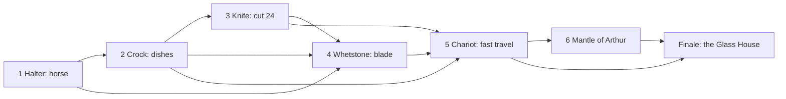

# The Valley Chapters: first complete version

This is the detailed plan for the first playable game: **six Treasure chapters set in
Blackmill and the Ogmore valley**, plus a short finale. It builds on `DESIGN.md` (draft 5).
The map lives on the character canvas, on the "Valley map" board.

- About **38 overworld screens** and **35 interior screens** (woods, tunnels, vaults,
  the cave).
- Roughly **3 to 4 hours** for a first play.
- **Mostly linear:** chapters 1 to 6 are played in order. Each chapter's power also opens
  optional **bonus areas** in places you've already been, a reason to go back.
- **Geography is game geography.** Real places are kept, but distances are squeezed and
  positions are approximate (the river down to Ogmore Castle is about 15 km in real
  life and 3 screens here). Corrections are welcome.

---

## The valley at a glance

| Area | Screens | Where on the map | Chapter |
| --- | --- | --- | --- |
| **Blackmill village** | 6 | Centre, where the Ogwr Fach meets the Ogwr Fawr | 1 (and the hub throughout) |
| **Allt-y-Rhiw** | 7 + 3 inside the fairy ring | North | 2 |
| **Dimbath and Dimbath Rocks** | 7 + 8 tunnels | North-east | 3 |
| **River Ogmore path** | 3 | South, following the river | 4 |
| **Ogmore Castle** | 3 + 5 vaults | Far south | 4 |
| **Cwm Rhyd y Milwr** | 4 | West, the valley climbing toward the mountain | 5 |
| **Mynwent y Milwyr** | 1 | On the mountain's shoulder | 5 |
| **Mynydd y Gaer** | 5 + church + 6 in the cave | North-west, above everything | 6 |

**Holy wells** (save points, and fast travel after chapter 5) are at the meeting of the
rivers, the edge of Allt-y-Rhiw, Dimbath valley, the Afanc pool and the mountain path.

**Day and night:** a day lasts about 12 minutes of play. The Hounds of Annwn only run at
night, mostly in Dimbath and Cwm Rhyd y Milwr. They don't come into the village, but you
can hear them from the Fox and Hounds.

---

## The power chain

| Chapter | Treasure | Power you keep | What it opens next |
| --- | --- | --- | --- |
| 1 | Halter of Clydno Eiddyn | **Horse**: gallop, jump fallen trees and streams | The fallen oak blocking Allt-y-Rhiw, and the river path south |
| 2 | Crock and Dish of Rhygenydd | **Conjure a dish**: give any creature exactly what it craves | Paying the Knockers' toll, calming the Afanc, a ghost's last meal |
| 3 | Knife of Llawfrodedd | **Cut 24 things at once**: briars, nets, ropes | The thicket on the river path, the ropes under the soldiers' ford |
| 4 | Whetstone of Tudwal | **Sharpen**: your staff becomes a blade while you fight bravely | The ghost captain's duel |
| 5 | Chariot of Morgan the Wealthy | **Fast travel** between wells, and the soldiers open the mountain road | Mynydd y Gaer, and later the trip to Bardsey |
| 6 | Mantle of Arthur | **Invisibility** while still or walking slowly | Gwyn ap Nudd's hidden court (bonus) and the finale |

---

## Chapter 1: The Runaway Pony (Halter of Clydno Eiddyn)

**Where:** Blackmill village and the riverbank. **About 25 minutes. This is the tutorial.**

- **Opening:** the player types their name. Early morning in Blackmill, with mist on the
  river and the mountain above. Cadi wakes you by barking at something glowing in the
  river where the two rivers meet.
- **The Glass Shard:** you wade in and pick it up. Merlin's voice, faint and cracked:
  *"…bring them home…"* The Shard hums and points toward the allotments.
- **The problem:** a wild grey pony is wrecking the allotments. An odd old rope halter
  hangs round its neck, and that's what the Shard is humming at. Chasing it fails: it
  bolts every time.
- **The puzzle:** work out what spooked it. Villagers' clues: "it came up from the river
  in a lather", and the Junction regulars joke about "the thing in the deep pool". Follow
  its hoofprints back to the river and see bubbles and a pair of eyes: the **Afanc**.
  Block the gap in the riverside fence with a cart (a push-block puzzle) so the pony
  can't get back to the water, then approach slowly. It calms, and you take the Halter.
- **The legend:** tie the Halter to your bedpost that night, and in the morning the
  horse you wished for is standing in it. Merlin tells the story of **Clydno Eiddyn**,
  and it goes into the Legends Book.
- **Teaches:** movement, talking, pushing, sneaking (walk slowly), the Shard's hum, day
  and night, saving at the well.
- **People you meet:** the Junction regulars (rumours), the Fox and Hounds landlord
  (first mention of the Hounds of Annwn: "white as frost, ears red as blood, I've heard
  them go past on a wild night"), and the chapel caretaker, who mentions "the old story
  that Arthur's buried on Mynydd y Gaer".
- **Bonus later:** the deep pool behind the allotments (chapter 3's Knife cuts the reeds)
  has a heart piece.

## Chapter 2: The Fair Folk's Feast (Crock and Dish of Rhygenydd)

**Where:** Allt-y-Rhiw. **About 35 minutes.**

- **Getting in:** a fallen oak blocks the woodland path. You jump it on horseback.
- **The wood:** ancient oaks and paths that shift. If you look closely, mushrooms ring
  the clearings. The Shard hums toward the **fairy ring** in the heart of the wood, but
  it's just a ring of mushrooms by day.
- **The puzzle chain:**
  1. An old woman gathering firewood (who is not quite what she seems) says the Fair
     Folk love cream and only dance at dusk.
  2. Get cream from the Fox and Hounds by finding the landlord's lost cat in the wood.
     Cadi sniffs it out.
  3. At dusk, pour the cream in the ring. The Fair Folk appear and pull you into their
     feast. You're inside the ring, which is 3 screens of glowing woodland.
- **The test:** the Crock and Dish sits on the feast table. The Fair Folk will trade it
  if you dance through three songs without stepping out of the pattern, a rhythm and
  movement mini-game. **Fairy time:** the longer you stay, the more time passes outside.
  Stay too long and you come out three days later, the village is worried, and the Junction
  regulars have new rumours. It's never a game over, just a reaction.
- **The legend:** whatever food you wish for appears in the Crock and Dish. Merlin tells
  of **Rhygenydd the Scholar** and why the Fair Folk wanted it.
- **Bonus later:** the bluebell dell (Knife) and a fairy shortcut path visible only with
  the Mantle.

## Chapter 3: The Knockers of Dimbath (Knife of Llawfrodedd)

**Where:** Dimbath valley, Dimbath Rocks and the old levels underneath. **About
40 minutes.**

- **The valley:** empty and quiet, with the ruined walls of ancient homesteads. A
  shepherd says that at night the rocks "aren't always rock". This is where you first
  see the Hounds of Annwn at a distance, if you're out late.
- **Getting in:** a collapsed coal level under Dimbath Rocks. Inside, you hear knocking.
  The **Knockers** won't show themselves until you pay their toll: their favourite food.
  Each Knocker wants something different (a hot pasty, bara brith, a jam tart), and the
  Crock conjures them. Get it wrong and they knock you back to the entrance.
- **The tunnels (8 screens, dark):** you need the lantern. **The Knockers' language:**
  learn three knock patterns from them, *safe*, *danger* and *this way*. Then cross the
  collapsing galleries by listening for the right knocks, a sound puzzle with visual
  cues for players who can't use sound.
- **Gwyn ap Nudd:** the deepest tunnel opens onto a cavern where, behind a curtain of
  roots, **Gwyn ap Nudd** holds court. He's courteous and unsettling. He lets you pass to
  the Knife "in exchange for a favour to be named later". That sets up the finale and a
  bonus area.
- **The Knife:** guarded by the Knockers' elder. It's stuck in a beam that's holding up
  the roof, so pulling it out brings the gallery down. Follow the Knockers' *this way*
  knocks to escape as the roof falls.
- **The legend:** the Knife of **Llawfrodedd the Horseman** serves twenty-four people at
  once. In the game, it cuts 24 things in one stroke.
- **Bonus later:** with the Mantle, sneak back into Gwyn's court at night, past the
  Hounds, for a heart piece and a Legends Book entry about Gwyn himself.

## Chapter 4: Down the River (Whetstone of Tudwal Tudglyd)

**Where:** the River Ogmore path south, then Ogmore Castle. **About 40 minutes.**

- **The river path (3 screens):** ride the horse along the bank. A thicket of briars and
  old fishing nets blocks the way, and one swing of the Knife clears it.
- **The Afanc pool:** the Afanc from chapter 1 blocks the narrow bank and lunges at
  anyone who passes. Feeding it the right thing calms it. A fisherman's clue says "it
  loves eels", so the Crock conjures a pie of eels. It falls asleep and you sneak past.
  Fighting it is possible but very hard, and the game hints that it's the wrong answer.
- **Ogmore Castle:** the ruin, the **stepping stones** across the river (some are wobbly
  and drop you in the water, so watch which ones the ducks stand on), and the castle
  grounds.
- **The White Lady:** she appears at dusk in the ruins and leads you down to the vaults
  (5 screens of puzzles: pressure plates, a flooded room, a lever sequence written as a
  rhyme). At the bottom, a chamber of gold, and the Whetstone.
  - She offers you **half the gold**. If you take **only the Whetstone**, she smiles,
    tells you her story and blesses you.
  - If you take anything else, the gold turns to dry leaves, she scratches you (−1 heart
    until the end of the chapter) and goes cold and silent. You still get the Whetstone.
    This is the real Ogmore legend: greed is punished. It's also tracked for the
    generosity ending.
- **The legend:** a brave person's blade sharpened on **Tudwal's** Whetstone always
  wounds; a coward's stays blunt. In the game, your staff becomes a blade, but it goes
  blunt again if you run from a fight.

## Chapter 5: The Soldiers' Ford (Chariot of Morgan the Wealthy)

**Where:** Cwm Rhyd y Milwr, then Mynwent y Milwyr. **About 40 minutes, mostly at
night.**

- **The valley:** by day it's a quiet valley with a ford. At night, **ghost soldiers**
  march down it to the ford, again and again, and the Hounds of Annwn are out. The Shard
  hums at three places: the Chariot is in pieces, and each piece is held by a ghost.
- **The three pieces:**
  1. **The wheel:** a young ghost soldier who never got his last meal before the battle.
     Use the Crock (his mam's cawl).
  2. **The axle:** tangled in old ropes and chains under the ford. You have to cut them
     all in one stroke as the water rises, so use the Knife.
  3. **The yoke:** held by the **ghost captain**, who will only give it up to someone
     brave enough to beat him. It's a duel, and the Whetstone-sharpened staff only
     works if you don't back away.
- **Rebuilding the Chariot:** in the legend it takes its rider anywhere at once. You can
  now fast-travel between wells, and send Treasures safely ahead.
- **Mynwent y Milwyr:** the captain asks you to lead the soldiers to their cairn. It's an
  escort through the night with the Hounds hunting you. The ghosts are afraid of them,
  and the Hounds keep away from your lantern. At the cairn the soldiers finally rest.
  The captain reveals **they were Arthur's men**, and that they've guarded the road up
  Mynydd y Gaer ever since he was laid there. They open the old road up the mountain.
- **The legend:** **Morgan the Wealthy's** Chariot.

## Chapter 6: The King Beneath the Mountain (Mantle of Arthur)

**Where:** Mynydd y Gaer, its old church, the hillfort and the cave. **About
45 minutes.**

- **The mountain:** windswept heath, the banks of the ancient fortress, and wide views
  over Blackmill.
- **The old church:** a carving, window or old painted board (depending on what's really
  there) shows a man cutting a hazel staff and a sleeping king beneath the roots. A
  verse says the king's men will wake if the bell is rung, and gives the answer to their
  question. This is your clue.
- **The hazel:** find the one hazel growing on the old fort's bank. Cadi digs at its
  roots, and a passage opens.
- **The cave (6 screens, dark):** Arthur's warriors sleep in rows, and treasure glitters
  between them. **A bell hangs in the narrowest passage.** A stealth puzzle: reach the
  sleeping king without brushing the bell, using walking speed, timing and light.
  - **If the bell rings,** a warrior sits up and asks **"Is it day?"** The church verse
    told you the answer: **"No, sleep on."** Say that and he lies back down. Say "Yes"
    and you're thrown out of the cave (a faint) and have to sneak back in.
- **The Mantle:** Arthur sleeps with his Mantle across his knees. You borrow it, and the
  moment you put it on you vanish. The legend says whoever wears it can see everything
  and be seen by no one. Merlin, from the Shard, is quietly moved: *"He always did sleep
  through everything."*
- **Getting out:** invisible, you slip past the bell. Back on the mountaintop at dawn
  you look down at Blackmill: the king was here all along.

## The finale (short version): the Glass House

- With the Chariot, which can take its rider *anywhere*, you can make the journey that
  would otherwise be impossible: to **Merlin's Glass House on Bardsey**.
- The house is a glass ruin with **twelve settings**. You place your six Treasures, and
  each placement plays a short scene from its legend in the glass. As you give them up,
  you lose each power.
- **Dyrnwyn** waits in the centre and reads your generosity across the six chapters:
  - The ghost soldier's meal, sharing food from the Crock, finding the landlord's cat.
  - Not taking the White Lady's gold.
  - Lending the horse to the shepherd, and other optional kind acts.
- **Generous:** the sword flames white. Half the Glass House fuses whole, and Merlin can
  speak clearly at last. He tells you six Treasures are still out in the wider world,
  and asks you to find them. **To be continued**, which sets up the expansion.
- **Not yet:** the sword burns your hand. Merlin tells you who you passed by, and you can
  go back and make it right before trying again.
- **Gwyn's favour:** on Bardsey, Gwyn ap Nudd appears and names the favour from chapter
  3. Under the glass, a smear of black flour: *"Ask the miller,"* he says, and
  disappears. That's a nod to Black Ifan, parked for later.

---

## Side quests and secrets (all optional)

| Side quest | Where | Reward |
| --- | --- | --- |
| The Junction noticeboard: lost things around the valley (a pocket watch, a lamb, a bike) | Village | Heart pieces, generosity |
| The landlord's cat | Allt-y-Rhiw | Cream (needed) and an extra story from the landlord |
| The shepherd's horse | Dimbath | Lend him your horse for a day; generosity |
| The deep pool | Behind the allotments | Heart piece (Knife) |
| Gwyn's court by night | Dimbath Rocks | Heart piece and Legends Book entry (Mantle) |
| The fairy shortcut | Allt-y-Rhiw | Quick route to Dimbath (Mantle) |
| Legends Book | Everywhere | One story per Treasure, plus extras for the White Lady, the Afanc, the Knockers, the Hounds and Gwyn |

## Build order

1. **Engine and village (chapter 1):** the whole tutorial chapter makes a good first
   playable build.
2. **Chapters 2 and 3:** adds the dish and cut powers, the fairy dance and the tunnels.
3. **Chapter 4:** the river and castle.
4. **Chapters 5 and 6:** night, escorts, stealth.
5. **Finale, side quests, polish.**
